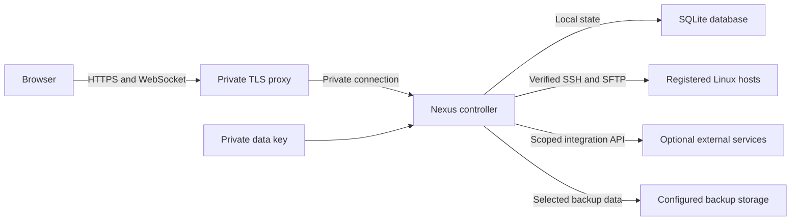

# Nexus architecture and security boundaries

The Go controller serves the Vue application and the HTTP and WebSocket APIs.
It stores local state in SQLite. Authenticated routes enforce action and
resource permissions. Named accounts join by invitation after an administrator
explicitly activates the first owner. Sessions can be revoked. Role grants can
be scoped to servers or groups. Background services have distinct authorities.

Nexus uses the configured data key to protect stored SSH credentials and
integration secrets. The database and data key together give an attacker
access to protected material, so restrict access to both. SSH applies host-key
verification before remote access. Servers and connected providers remain
separate trust boundaries. A permitted terminal, file write, or deployment
can affect a remote host with the OS account's permissions.

## Review guide

| Boundary | Code and evidence to review |
| --- | --- |
| Sessions and permissions | `nexus/internal/auth`, `authorization`, API middleware, and WebSocket session tests |
| SSH and secrets | `nexus/internal/ssh`, `crypto`, credential handling, and rotation and recovery fixtures |
| Privileged operations | `nexus/internal/operations`, `scheduler`, `terminal`, `filemanager`, and remote adapter fixtures |
| Providers and automation | GitHub Actions, Ansible, Vault, proxy, and certificate adapters. Check scopes, input validation, and provider request boundaries. |
| Recovery | `nexus/internal/backups` and the packaged and native recovery fixtures. Check source access, job authority, and restore destinations. |

Run the [contributor checks](CONTRIBUTING.md), the hosted CI and native
integration suites, and the [recovery procedure](DEPLOYMENT.md#recover-or-roll-back)
in a disposable environment. These checks supply automated evidence. An
independent reviewer should inspect grant composition, revocation during active
work, credential lifetime and redaction, sensitive path handling, and partial
failures during remote changes and restores.

The controller is a high-trust management service. Deploy it on a private
network and separate privileged operator accounts. A self-hosted instance uses
a single SQLite database. Back up its local state and test recovery for the
dependencies you operate.
