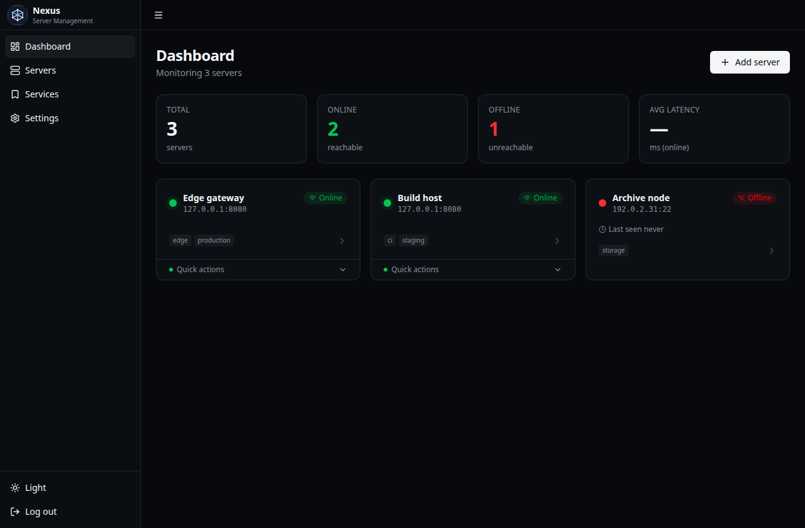
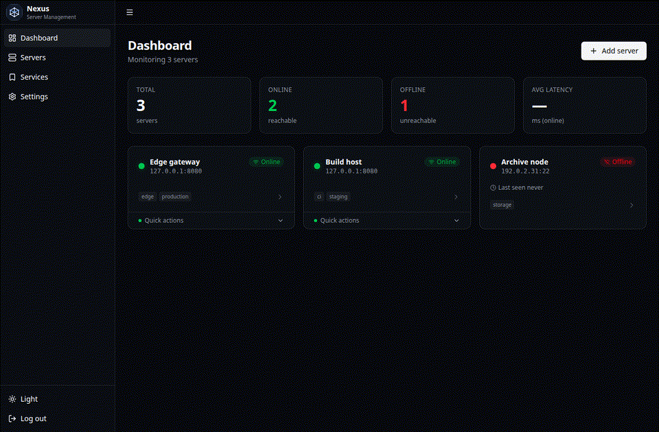

# Nexus


Nexus is a self-hosted dashboard for Linux infrastructure. Connect your servers over SSH to inspect what runs on them, manage containers, run approved automation, and back up selected data. Nexus runs on infrastructure you control and works without a Nexus cloud account.

[](https://github.com/xmahdi1/nexus/actions/workflows/ci.yml)
[](LICENSE)



<details>
<summary>Watch a short tour of the dashboard, servers, and services</summary>



</details>

The screenshots and recording use fictional infrastructure in an isolated local fixture.

## Get started

On a Linux host with Git, Python 3, Docker Engine, and Compose v2:

```sh
git clone https://github.com/xmahdi1/nexus.git
cd nexus
python3 scripts/deploy.py
```

Choose **New** for a fresh installation or **Migrate** to copy an existing Nexus installation. The installer builds the image, prompts for setup choices, and starts Nexus on a loopback port. Connect through a private HTTPS proxy before signing in. At the first sign-in, leave **Username** empty and enter the administrator password you configured.

For a manual Compose installation, native development, or migration and rollback instructions, see the [deployment guide](DEPLOYMENT.md). Source builds require network access to fetch dependencies and a local Docker engine. Managed servers need reachable SSH and an OS account with access to the tools you plan to use.

## What you can do

| Area | Available tools |
| --- | --- |
| Servers | SSH terminal, SFTP files, live metrics, scheduled tasks, cron, and service bookmarks |
| Discovery | Host hardware and OS, disks and mounts, DNS resolver settings, listeners, loaded systemd services, Docker objects, and observed reverse-proxy routes |
| Apps and Docker | Container logs and lifecycle, saved Compose deployments, Marketplace apps, and custom templates |
| Networking | nginx and Caddy configuration, certificates, port inspection, and UFW rules |
| YAML Editor | Edit server YAML with syntax highlighting and suggestions for Compose, GitHub Actions, and Kubernetes manifests |
| Automation | Ansible inventory and controller projects, review and approval, scheduled runs, and optional Vault secret references |
| GitHub | GitHub App connections, workflow dispatch and run views, workflow edits via draft PRs, and self-hosted runner setup |
| Vault | Deploy HashiCorp Vault and manage supported operations such as KV v2, policies, auth, leases, PKI, audit, and transit |
| Backup and recovery | Discover and select supported files, volumes, databases, and Nexus recovery data. Run once or on a schedule. Use mounted storage or S3 and verify restore copies. |
| Access | Invitation-only accounts, MFA and recovery codes, server and group grants, revocable sessions, and audit history |

Inventory, Vault, automation, and guided backups are opt-in. Nexus discovers hosts you have registered. YAML suggestions help edit Kubernetes manifests. See the [roadmap](ROADMAP.md) for planned runtime management and the [security policy](SECURITY.md) for deployment boundaries.

## How Nexus runs

A single Go service serves the Vue dashboard and API and keeps local state in SQLite. The controller uses the SSH credentials you configure to connect to registered hosts. Most host operations run on those hosts. Ansible runs on the selected controller, and GitHub workflows run on GitHub-hosted or registered self-hosted runners.

Keep the Nexus configuration, data key, and database together in recovery storage. Back up remote application data separately. Review the [security architecture](ARCHITECTURE.md) and [recovery instructions](DEPLOYMENT.md#recover-or-roll-back) before operating Nexus on shared infrastructure.

## Project links

- [Deploy, migrate, and recover](DEPLOYMENT.md)
- [Release process and image verification](RELEASING.md)
- [Contribute and run checks](CONTRIBUTING.md)
- [Get help](SUPPORT.md)
- [Report a security issue](SECURITY.md)
- [Roadmap](ROADMAP.md)
- [MIT License](LICENSE)
